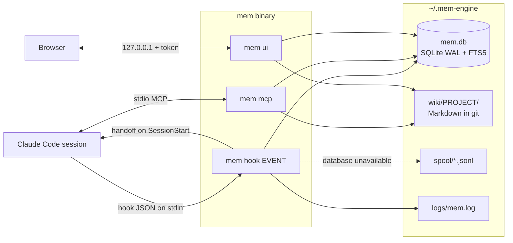
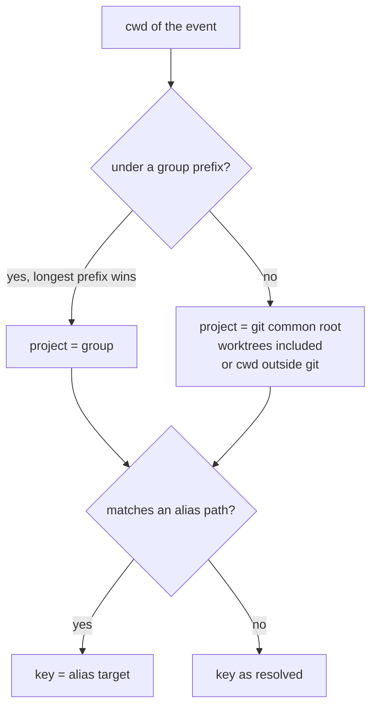
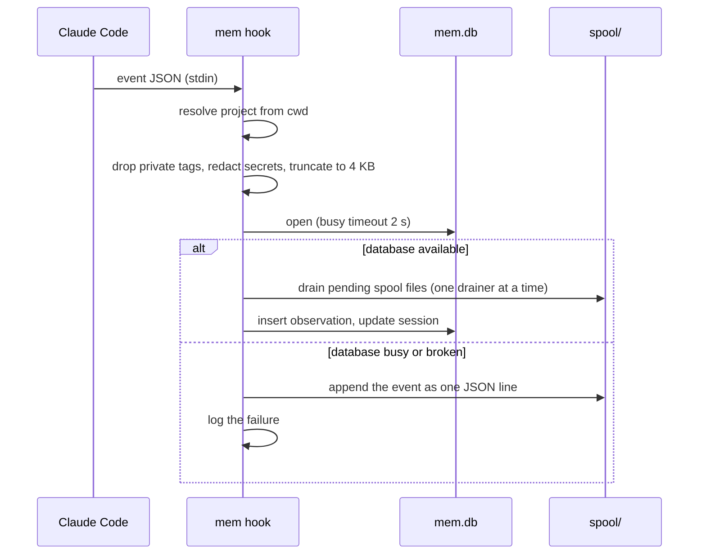
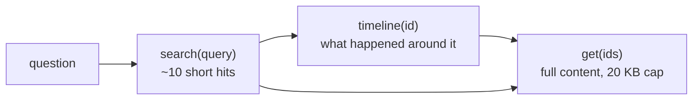
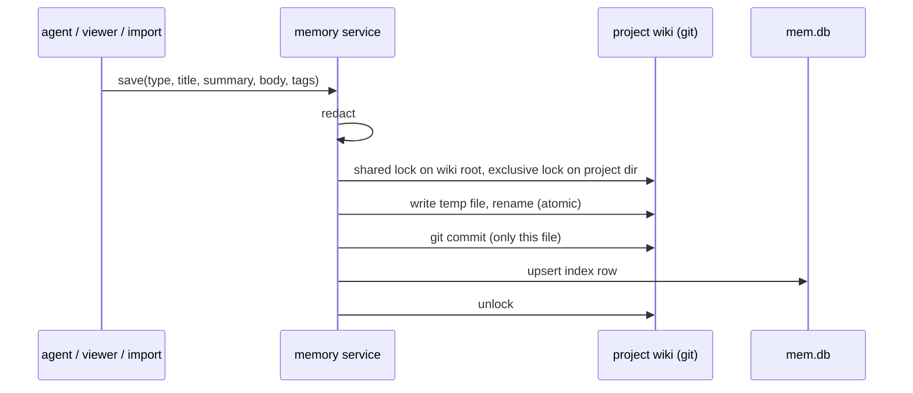

# How mem-engine works

mem-engine is one binary, `mem`, with no resident process. Claude Code runs it as a hook on every event, as an MCP server over stdio while a session is open, and you run it yourself for `mem ui`, `mem doctor` and the other commands. Every one of those processes reads and writes the same data directory.

## Overview



There are two kinds of data, with different homes:

| | Observation | Memory |
|---|---|---|
| What | Something that happened: a prompt, a tool call and its result, a tool error, the end of a turn, a compaction, the start of a session | Something worth keeping: a fact, decision, gotcha, preference or reference |
| Written by | Hooks, automatically | The agent (`save`), the viewer or `mem import`, on purpose |
| Stored in | SQLite only | A Markdown file with frontmatter in the project's git wiki, indexed in SQLite |
| Lifetime | Deleted after `retention_days` (90 by default) | Until it is forgotten |
| Source of truth | The database | The wiki; `mem reindex` rebuilds the index from it |

## Projects and isolation

Every event carries the working directory, and every read and write is scoped to a project resolved from it:



The project key is an absolute path. Its wiki directory is a readable slug of the name plus a short hash of the key, such as `billing-api-3fa2c1`.

Searches see two scopes: the current project and `user`, a personal scope visible everywhere. Nothing from another project shows up unless it is asked for explicitly.

## Capture

Each hook runs `mem hook <Event>` with the event JSON on stdin. All capture hooks are registered with `async: true`, so they never block the agent's turn. Only `SessionStart` (which returns the handoff) and `SessionEnd` (with a 1.5 s budget) are synchronous.



Rules that keep capture honest:

- Capture never calls an LLM and never sends anything over the network.
- Redaction runs before any write to the database, the spool, the log or the wiki: builtin patterns for common tokens, keys and connection strings, plus your own `redact_extra` patterns.
- An event that cannot be written is never dropped: it goes to `spool/`, and the next process that opens the database applies it. `mem doctor` reports pending spool lines and recent capture errors.
- Tools whose name matches `skip_tools` are not captured (by default, mem-engine's own MCP tools).

## Session start: the handoff

`SessionStart` records the event, runs the daily retention cleanup, and returns a short text in `hookSpecificOutput.additionalContext`, hard-capped at 1,200 characters:

```
mem-engine | project billing-api
Last session 2026-11-20 14:02: asked "fix the retry loop"; edited a.go, internal/b.go; stopped at "Done, retry now backs off"
Memories: m-1a2b3c Retry policy for payments; m-4d5e6f Ledger naming
Lookup: search -> timeline -> get (memory tools of this project).
```

The "where it stopped" line is built without an LLM: the last prompt, the last edited files and the last assistant message of the previous session. After a compaction, the compaction summary takes its place. The whole step runs in a goroutine with a 5 s deadline; past it, the hook answers with the minimal handoff (just the project line) so a slow disk or a stuck lock never holds the session.

## Layered search (MCP)

`mem mcp` serves six tools over stdio. The descriptions teach the agent to go from cheap to expensive:



- `search` runs an FTS5 query on memories and observations in the current scope. Each corpus is ranked by BM25, normalized to the best hit, weighted 2 for curated memories and 1 for observations, and multiplied by a recency factor `1 / (1 + age_days / 30)`.
- `timeline` lists the neighbours of an item in the same session, in short form.
- `get` returns the full content of the ids asked for, with a total size cap.
- `save`, `update` and `forget` manage curated memory.

## Curated memory



- One commit per operation, with a fixed author, so the wiki history is the audit log of every memory.
- When the file and the index disagree, the file wins. `mem reindex` takes the wiki root lock exclusively and rebuilds the index from every project's Markdown files.
- `forget` re-reads the memory after taking the lock. If a concurrent `mem project merge` moved it to another project in the meantime, it answers "not found" instead of following it outside the scope the caller checked.

## Viewer

`mem ui` starts an HTTP server on `127.0.0.1` with the HTML and JS embedded in the binary. It prints a URL with a random token generated for that run; every request must carry the token, and the `Host` and `Origin` headers must point to the loopback address, which blocks DNS rebinding and cross-site requests. The feed polls for new observations every 2 seconds. Edits and deletions of memories go through the same memory service as the MCP tools, so they are committed to the wiki too.

## Concurrency

Several hooks, the MCP server and the viewer can run at the same time, from several Claude Code sessions. What keeps them consistent:

| Shared resource | Protection |
|---|---|
| `mem.db` | SQLite in WAL mode with `busy_timeout`, `synchronous=NORMAL`, write transactions with `BEGIN IMMEDIATE`. Opening an up-to-date database only reads the schema version, without taking the write lock |
| Schema migration | Runs at open, inside a write transaction, retried while the database is busy. A binary older than the database refuses to write |
| `spool/` | A non-blocking file lock next to the spool directory: one process drains, the others skip. Each file is claimed by renaming it, so a process that dies mid-drain leaves a claim that is picked up after a minute |
| Wiki | A file lock per project directory, and a lock on the wiki root that is shared for writes and exclusive for `mem reindex` |

## Migration from native memory

`mem import` reads the native memory files (one Markdown file with frontmatter per memory) and saves each one as a curated memory, keeping its type and description, rewriting `[[links]]` to the new ids and tagging it with its source file, so running it again skips what was already imported. Once the import looks right, `mem setup --disable-native-memory` sets `autoMemoryEnabled: false`, and Claude Code stops loading `MEMORY.md` next to the handoff.

## Repository layout

| Path | Role |
|---|---|
| `cmd/mem` | Command-line entry point and subcommands |
| `internal/capture` | Hook handling: payload, redaction, spool fallback, handoff output |
| `internal/store` | SQLite schema, migrations, observations, sessions, search, retention |
| `internal/spool` | Append-only fallback queue and its drain |
| `internal/wiki` | Markdown files with frontmatter, locks and git commits |
| `internal/memory` | Curated memory service: save, update, forget, reindex, project moves |
| `internal/project` | Project resolution: git root, groups, aliases |
| `internal/redact` | Private tags and secret patterns |
| `internal/handoff` | The session-start text |
| `internal/mcpserver` | MCP tools over stdio |
| `internal/ui` | Local HTTP API and embedded front end |
| `internal/importer` | Native memory import |
| `internal/setup`, `internal/doctor`, `internal/bench` | `mem setup`, `mem doctor`, `mem bench` |
| `plugins/mem-engine`, `.claude-plugin` | Claude Code plugin and marketplace |
